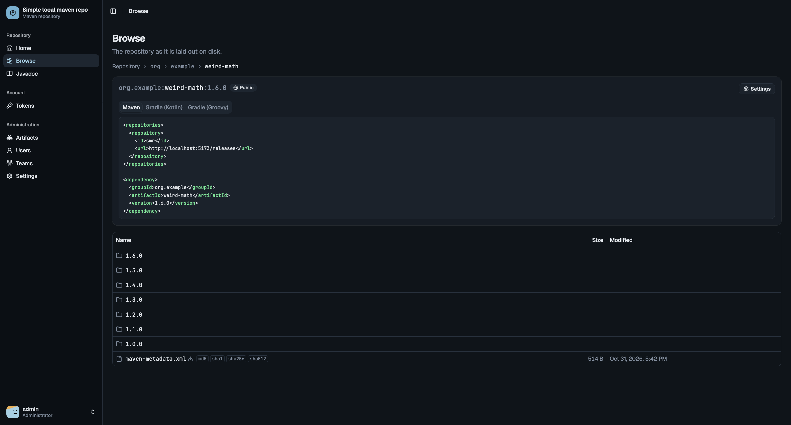
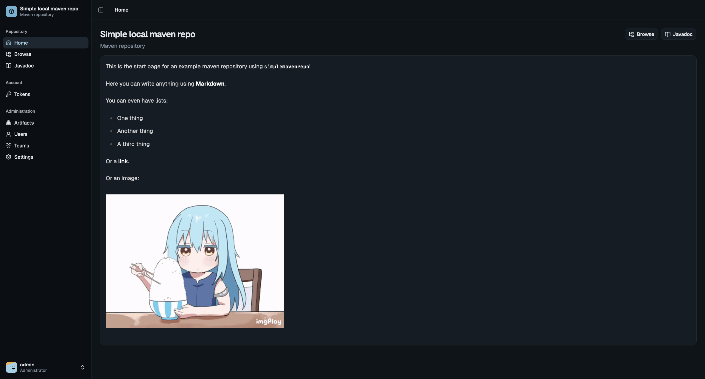
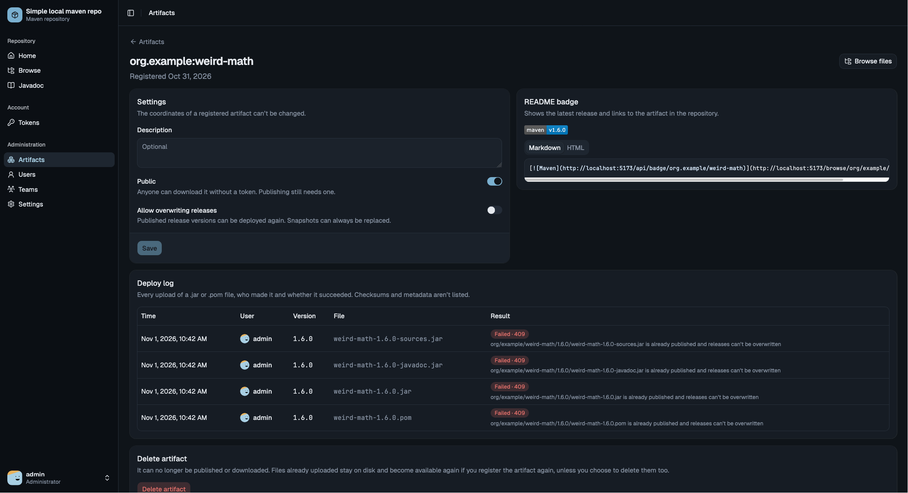
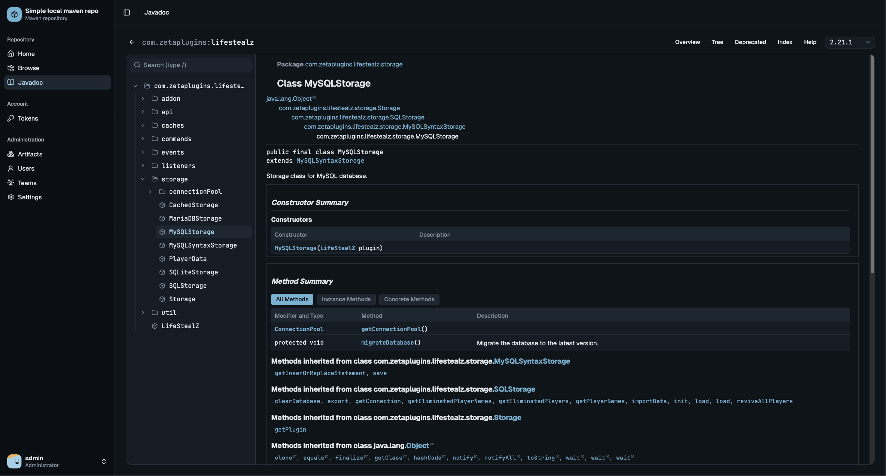
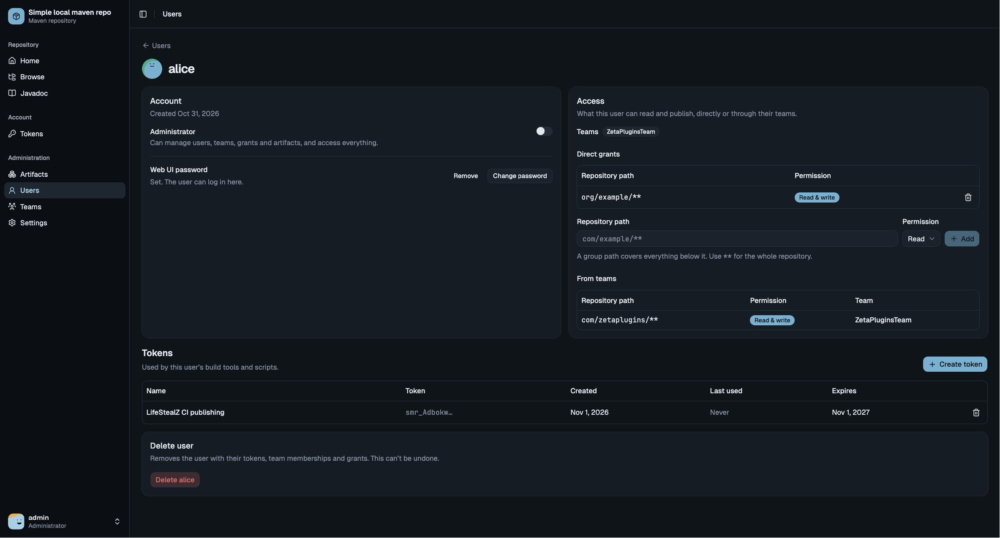

<h1>
  <picture>
    <source media="(prefers-color-scheme: dark)" srcset="./web/public/logo_dark.svg" />
    
  </picture>
</h1>

A very simple way to host your own Maven repository for your Maven and Gradle projects. It comes as a single
service with a web UI that makes it easy to manage the repository: register artifacts, manage users and tokens,
and decide who can read or publish what.

No complex setup, no plugins, no external database. Start the container, log in, and point your build at it.



## Features

- **Browse the repository** in the web UI, with ready to copy dependency snippets for Maven, Gradle (Kotlin) and Gradle (Groovy).
- **View javadocs** right in the browser. Publish a javadoc jar alongside your artifact and it shows up automatically, with search and a version switcher.
- **Public and private artifacts.** Public artifacts can be downloaded by anyone, private ones require a token.
- **Fine grained permissions if you want them.** Grant users or teams read or write access to a whole group (like `com/example/**`) or a single artifact. If you don't need that, admins can access everything and you can ignore it.
- **Access tokens** for Maven and Gradle, created per user from the web UI. Tokens can be restricted to single artifacts, so a leaked CI token only exposes what it publishes.
- **Users and teams** to organize who has access to what.
- **Release and snapshot** versions, with optional protection against overwriting releases.
- **Download statistics** per artifact and version, with charts over time for admins.
- **README badges** showing the latest version of an artifact or its downloads per week, month, year or in total.

## Screenshots

<table>
  <tr>
    <td>
      
    </td>
    <td>
      
    </td>
  </tr>
  <tr>
    <td>
      
    </td>
    <td>
      
    </td>
  </tr>
</table>

## Getting started

You need [Docker](https://docs.docker.com/get-docker/) with Docker Compose.

1. Clone the repository and start the container:

    ```bash
    git clone https://github.com/KartoffelChipss/simplemavenrepo.git
    cd simplemavenrepo
    docker compose up -d
    ```

2. On the first start an `admin` user is created. Its password and an access token are printed to the log once,
   so store them right away:

    ```bash
    docker compose logs simplemavenrepo
    ```

3. Open [http://localhost:4321](http://localhost:4321) and log in as `admin`.

4. It is recommended to create a new user for yourself and delete the `admin` user.

5. Register an artifact under **Artifacts** and create a token under **Tokens**. Then configure your build to
   publish to `http://localhost:4321/releases` as described in the [publishing guide](MAVEN_PUBLISH_GUIDE.md).
   Once published, the artifact page shows how to add it as a dependency.

The repository files and the configuration are stored in the `repo` and `config` Docker volumes.

## License

simplemavenrepo is licensed under the [GNU General Public License v3.0](LICENSE).
